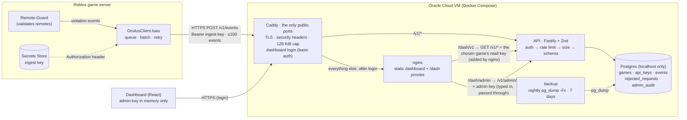

# Oculus

[](https://github.com/bss-k/oculus/actions/workflows/ci.yml)
[](LICENSE)


Security telemetry for games. Game servers running [Remote-Guard](https://github.com/bss-k/Remote-Guard)
report exploit and violation events to a hardened ingest API; a dashboard shows what is being
attacked, by whom, and whether the guard is blocking it (`enforce`) or only watching (`shadow`).

## Architecture



Request lifecycle for every endpoint:

```
deploy only: Caddy            → TLS, 128 KiB body cap (413, not logged), login for non-/v1 paths
onRequest:   requireKey(scope) → 401/403 bad_key        (before the body is read; 401 "expired" past a grace period)
             rateLimit(key)    → 429 rate_limited       (separate buckets: ingest, read, admin)
parse:       bodyLimit 128 KB  → 413 too_large
             JSON parser       → 400 invalid_schema     (malformed JSON, __proto__ keys)
handler:     Zod strict schema → 400 invalid_schema     (unknown fields, types, ranges)
any refusal → one rejected_requests row (reason, key if known, ip, route, detail)
```

| Folder | What's in it |
| --- | --- |
| `api/` | Node + TypeScript + Fastify API, SQL migrations, key, seed and load-test scripts, Vitest tests |
| `web/` | React + TypeScript + Vite dashboard (Overview, Violations, Players, Remotes, Ingestion & keys) |
| `caddy/` | Deploy entry point: HTTPS, security headers, the dashboard login |
| `scripts/` | `dev.mjs`, `smoke.mjs` (end-to-end check of a deploy), `backup.sh`, `restore.sh` |
| `roblox/` | `OculusClient.luau`, the server-side module that ships events |
| `docs/` | [Deploying on Oracle Cloud](docs/deploy-oracle.md), [connecting a Roblox game](docs/roblox-integration.md) |

## Local setup

Requires Node 20+ and Docker.

```bash
docker compose up -d db   # Postgres on localhost:5432 (also creates the test database)
npm install
npm run setup             # migrations + two demo games (~2.9k events); writes their read keys to web/.env.local
npm run dev               # API on :3000, dashboard on http://localhost:5173
```

`npm run setup` also prints a dev **admin key** for each game: paste it into the Ingestion & keys
screen to try key management. The two demo games ("Demo Game" and "Demo Obby") show the game menu
in the dashboard header. Run the checks CI runs: `npm run lint`, `npm run typecheck`, `npm test`.

## Several games on one dashboard

One deploy can show several Roblox games (universes). The API was always per game: each key
belongs to one game, and every endpoint only sees its key's game. The dashboard picks the game:

- `.env` lists one read key per game: `OCULUS_READ_KEYS=my-game=ocl_...,other-game=ocl_...`
  (the older `OCULUS_READ_KEY=ocl_...` still works for a single game).
- When the `web` container starts, `web/render-read-keys.sh` checks that list and writes it
  into nginx's config, plus `/dash/games.json`, which lists only the slugs (no keys).
- The dashboard sends the chosen slug in an `X-Oculus-Game` header; nginx swaps it for that game's
  read key. An unknown or missing slug gets a 400, never another game's key. Read keys never reach
  the browser. In dev, `web/vite.config.ts` does the same from `web/.env.local`.
- The game menu in the header (shown with 2+ games) is remembered in the browser's localStorage
  (the slug only). Switching remounts every screen, so nothing carries over between games.
- Key management stays per game: an admin key manages only its own game. The keys screen refuses
  an admin key for a different game than the one on screen, and switching games locks it.

Adding a game: create its read, ingest and admin keys with `create-key` (a new `--universe`),
add `slug=<read key>` to `OCULUS_READ_KEYS`, then `docker compose --profile deploy up -d web`.

## Threat model

Only Roblox game servers can call the ingest API (Roblox clients cannot make HTTP requests),
but the API is on the public internet, so anyone can try. Each defense covers one specific threat:

| Threat | Defense | Where |
| --- | --- | --- |
| Keys or dashboard data read off the network | HTTPS for everything: Caddy terminates TLS with automatic Let's Encrypt certificates, redirects HTTP, and sends HSTS | `caddy/Caddyfile` |
| Strangers open the dashboard | Login (HTTP basic auth over HTTPS) on every dashboard page and `/dash` call; only a bcrypt hash of the password is in `.env` | `caddy/Caddyfile`, `caddy/start.sh` |
| The dashboard framed by another site, content-type sniffing, leaking URLs in `Referer` | `X-Frame-Options: DENY`, `X-Content-Type-Options: nosniff`, `Referrer-Policy: no-referrer`; no `Server` header | `caddy/Caddyfile` |
| Someone skips Caddy and talks to the API or nginx directly | Only Caddy publishes ports; the API, nginx and Postgres are reachable only inside the compose network (Postgres also on the VM's loopback) | `docker-compose.yml` |
| A client fakes its IP in `X-Forwarded-For` to dodge the rejection-log cap | Caddy replaces the header with the real client IP; the API trusts it (`TRUST_PROXY`) only because nothing else can reach the API | `docker-compose.yml` |
| Someone posts fake events or reads another game's data | Per-game API key in `Authorization: Bearer`; every query is scoped to the key's game | `plugins/guards.ts`, `repo/` |
| Database leak exposes working keys | Keys stored as SHA-256 hashes only; the raw key is shown once (CLI output or the rotate response, sent `Cache-Control: no-store`), never in any list or log | `lib/keys.ts`, `routes/admin.ts` |
| Dashboard credentials let someone post events or manage keys | Three key scopes (`ingest`, `read`, `admin`); each endpoint accepts one, wrong scope → 403 | `api_keys.scope` |
| Read key leaks from the browser | The browser never sees it: the Vite proxy (dev) or nginx (deploy) adds it server-side. With several games the browser sends only a game slug, and an unknown slug is refused rather than given another game's key | `web/vite.config.ts`, `web/nginx.conf.template`, `web/render-read-keys.sh` |
| Admin key leaks from the browser | Typed in by the person when needed, held in React state only (no storage, URL or cookie), cleared on Lock, leaving the screen or reload; the proxy passes it through and never stores or adds one | `KeysPanel.tsx`, `/dash/admin` proxies |
| A leaked key keeps working | Rotation with a grace period (0–7 days): both keys work until the old one's `expires_at`, then it gets 401 "expired"; at most two usable keys per scope, enforced under a lock on the game's row; revoke is immediate | `repo/keys.ts` |
| Key management locks everyone out | Admin keys can't be rotated or revoked from the dashboard, only replaced with the CLI; one admin key per game (unique index) | `routes/admin.ts`, migration 003 |
| Key changes go unnoticed | Every rotation and revocation (dashboard or CLI) writes an `admin_audit` row in the same transaction | `repo/keys.ts` |
| A buggy or compromised server floods the API | Token bucket per key (ingest: 20 burst, 60/min; admin: its own, smaller bucket) with `Retry-After` | `lib/tokenBucket.ts`, `server.ts` |
| Huge bodies exhaust memory | 128 KiB cap at Caddy and in the API, max 100 events per batch | `caddy/Caddyfile`, `server.ts`, `schemas/events.ts` |
| Malformed or malicious payloads (extra fields, wrong types, `__proto__`) | Strict Zod schemas (unknown fields rejected), length caps on every string, Fastify's prototype-poisoning check | `schemas/` |
| Replayed or back-dated events skew charts | Timestamps must be within the last 24h and no more than 5 min in the future | `schemas/events.ts` |
| Bad-key floods fill the `rejected_requests` table | Rejection logging is itself rate limited per (reason, IP) | `plugins/errorHandler.ts` |
| Exploiter-controlled text (in violation details) breaks the client | The Luau client truncates every field to the API's limits and replaces invalid UTF-8 | `OculusClient.luau` |
| SQL injection | Parameterized queries only; batches use `unnest()` with typed arrays | `repo/` |
| Key stolen from a game place file | Key lives in the Roblox Secrets Store, never in scripts | `OculusClient.luau` |
| Losing the VM loses the data | Nightly `pg_dump` with 7 days kept, a tested restore script, and a documented off-VM copy | `scripts/backup.sh`, `scripts/restore.sh` |

**Why no HMAC request signing:** Roblox Secrets can only be placed in URLs or headers, never
used to compute a signature over the body, so the key is sent as a bearer token.

**Why the admin key isn't sent as `Authorization` by the browser:** on the deployed site that
header already carries the dashboard login (basic auth), so the browser sends the admin key as
`X-Oculus-Admin-Key` and the `/dash/admin` proxy turns it into `Authorization: Bearer` for the API.

**Known limits:**
- The dashboard login is one shared username and password, not per-person accounts, and
  failed logins aren't rate limited (each guess costs a bcrypt check). Use a long random password.
- The admin key is typed into the browser. Script injection into the dashboard (none is known)
  could read it while unlocked; lock the screen when you're done.
- Rate limits are kept in memory, so they're per instance. That's correct for one VM, but
  would need Redis or similar if the API ever runs on several instances.
- Bodies over 128 KiB are refused by Caddy, so they don't appear in `rejected_requests`.
- Backups are written to the same VM; copying them elsewhere is a manual step (see the deploy guide).
- The Players and Remotes lists aggregate every event in the window on each request, so they get
  slower as volume grows. The queries are written so Postgres can hash rather than sort (see the
  comments in `repo/players.ts` and `repo/remotes.ts`), but beyond a few million events per window
  they'd need counts maintained as events arrive. `npm run loadtest` measures this on your own setup.

## API

All endpoints need `Authorization: Bearer <key>`. Every refusal returns `{ "error": "<reason>", "message": "..." }`.

| Method | Path | Key | Returns |
| --- | --- | --- | --- |
| POST | `/v1/events` | ingest | `202 { accepted }` |
| GET | `/v1/stats/summary` | read | 24h totals, enforce/shadow split, unique players/servers, counts by rule |
| GET | `/v1/stats/hourly` | read | 24 hourly buckets `{ hour, shadow, enforce }` |
| GET | `/v1/stats/top-remotes?limit=5` | read | most-hit remotes, 24h (limit 1–20) |
| GET | `/v1/violations?rule=&playerId=&remote=&limit=50&cursor=` | read | newest first, keyset-paginated (`nextCursor`); optional rule / player / remote filters |
| GET | `/v1/players?window=24h&sort=total&q=&limit=25&offset=0` | read | one row per player: latest name, total/enforced/shadowed, rules hit, remotes hit, first/last seen. `sort`: `total`, `enforced`, `lastSeen`. `q`: name prefix, or an exact player ID if numeric. Offset-paginated (`nextOffset`; limit ≤ 50, offset ≤ 1000) |
| GET | `/v1/players/:playerId?window=24h` | read | summary, `byRule`, `byRemote`, distinct servers, time `buckets`; 404 if the player has no events in this game |
| GET | `/v1/remotes?window=24h&sort=total` | read | one row per remote (up to 200): totals, unique players, `byRule`, last seen, current `mode` (of its newest event), time `buckets` for a sparkline. `sort`: `total`, `enforced`, `uniquePlayers` |
| GET | `/v1/remotes/:remote?window=24h` | read | summary, `byRule`, top 10 players, time `buckets`; 404 if the remote has no events in this game. URL-encode the name (≤ 100 chars) |
| GET | `/v1/ingestion?window=24h` | read | per bucket, by arrival time: accepted events, and refused requests by reason (only those made with this game's keys, expired and revoked ones included); totals; `unattributedBadKey`: refusals whose key matched no game, counted across **all games** on the server |
| GET | `/v1/ingestion/servers?window=24h` | read | per `serverId`: events, first/last received, `silent` if nothing arrived for 10+ minutes (up to 200 servers, most recent first) |
| GET | `/v1/admin/keys` | admin | the game's keys: id, prefix, scope, created/last used/expires/revoked times, `status` (`active`, `expiring`, `expired`, `revoked`). Never a hash |
| POST | `/v1/admin/keys/rotate` | admin | body `{ scope: "ingest" \| "read", graceHours: 0–168 }` (default 24). `201` with the new raw key (only time it's shown) and the old key's new expiry; `409 grace_in_progress` if an older key is still in its grace period (only `graceHours: 0` is allowed then) |
| POST | `/v1/admin/keys/:id/revoke` | admin | revokes immediately; `403` for admin keys, `404` for another game's key, `409` if already revoked |
| GET | `/v1/admin/audit?limit=50&cursor=` | admin | rotations and revocations, newest first, keyset-paginated (`nextCursor`) |

`window` is `1h`, `24h` (default) or `7d`. Chart `buckets` are `{ start, shadow, enforce }`, oldest first:
12 × 5 min, 24 × 1 h or 28 × 6 h. They are rolling (the newest ends at the time of the request), and
each response's queries read one database snapshot, so buckets and breakdowns always add up to the
totals. Player and remote lists use offset paging because they are sorted by counts computed per
request, which no index can seek on; the violations list keeps keyset paging. A remote named exactly
`.` or `..` can't be opened by path (URL parsers drop dot segments), but still shows in lists and
timelines.

Every admin response is sent `Cache-Control: no-store`, and every admin action writes one
`admin_audit` row in the same transaction as the change.

Event shape (`timestamp` is Unix milliseconds):

```json
{ "events": [{ "timestamp": 1763664000000, "serverId": "6c1f…", "playerId": 123456,
  "playerName": "Builderman", "remote": "Attack", "rule": "RateLimit",
  "detail": "40 calls/s exceeds limit of 5/s", "mode": "enforce" }] }
```

## Roblox setup

In short: an ingest key as the `OculusApiKey` secret in Creator Hub, HTTP requests allowed,
`OculusClient.luau` in ServerScriptService as a Remote-Guard sink. Step by step, with a Studio
play-test plan and how to rotate the ingest key: [docs/roblox-integration.md](docs/roblox-integration.md).

The client flushes every 5s (up to 3 batches of 100), retries 429/5xx/network errors with
exponential backoff and jitter, drops 4xx batches immediately, and caps its queue at 1000
events (with one warning per interval).

## Deploy (Oracle Cloud VM)

Full guide, from an empty Oracle account to a smoke-tested deploy, with backups, restore and
moving hosts: [docs/deploy-oracle.md](docs/deploy-oracle.md). In short:

```bash
cp .env.example .env    # POSTGRES_PASSWORD, DOMAIN, DASHBOARD_USER, DASHBOARD_PASSWORD_HASH (single quotes)
docker compose --profile deploy up -d --build
# first boot stops at the dashboard (no read key yet): create read, ingest and admin keys
docker compose --profile deploy exec api node dist/bin/create-key.js --game "My Game" --universe <id> --scope read
# put the read key in .env as OCULUS_READ_KEYS=my-game=<read key> (one slug=key per game), then:
docker compose --profile deploy up -d
BASE_URL=https://<DOMAIN> OCULUS_INGEST_KEY=... OCULUS_READ_KEY=... node scripts/smoke.mjs
```

Caddy is the only service with public ports (80/443). The API, the dashboard (nginx) and
Postgres are only reachable inside the compose network. The API and dashboard have
healthchecks, everything restarts unless stopped, and the `backup` service dumps the database
nightly into `./backups`.

## Tests

213 API tests (Vitest, against a real Postgres via `app.inject()`, no network):
validation (11 bad-payload cases, malformed JSON, prototype pollution), auth (missing, malformed,
unknown, revoked, expired, wrong-scope keys), payload size, per-key rate limiting, rejection-log
flood cap, and every query endpoint (24h window, per-game isolation, rule filter, cursor paging
with no gaps or duplicates).

The Players and Remotes endpoints add: events just inside vs just outside each window (1h, 24h, 7d),
bucket edges, every sort, name/ID search (renamed players, literal `%` and `_`), the offset and row
caps, URL-encoded remote names, 404 without a rejection log, strict validation of every param, 403/401
for ingest or missing keys, the violations `playerId`/`remote` filters combined with `rule` and
cursor paging, and the read-only snapshot that keeps a response's numbers consistent while ingest runs.

Keys and admin endpoints add: a key working until `expires_at` and refused (401 "expired") after;
both keys working through a grace period; `graceHours: 0` ending the old key at once; a third
usable key being impossible, including when 6 rotations race (the tests fail if the per-game lock
is removed); one admin key per game; read and ingest keys refused on every admin endpoint;
another game's key ids answering 404; admin keys never revocable; each read and admin key
reporting its own game (what the dashboard's game check relies on); exactly one audit row per action
and none for refused ones; the raw key only in the rotate response and no hash in any response;
the admin rate-limit bucket; strict validation of every new param and body. Ingestion: window
boundaries by arrival time, per-game isolation, refusals attributed to the game's keys (expired
ones included), unattributed bad-key refusals counted separately, and the silent-server flag.

CI also builds both Docker images and validates the Caddyfile, the rendered nginx config (with
several games and with the single-key setting) and the compose file.

## Metrics

Not measured yet. Capture these from the live deploy (not the seed), and note the date and data
volume next to each:

- **Ingest throughput and latency.** `npm run loadtest -w api -- ingest --url <base>` with
  `OCULUS_INGEST_KEY` for a throwaway game: accepted events/s and p50/p95/p99 per 100-event batch.
  Normal rate limits cap a key at 60 batches/min, so measure the server on an instance with higher
  `INGEST_*` limits, and real usage on the live one.
- **Dashboard query time at real volume.** `npm run loadtest -w api -- reads --url <base>` with
  `OCULUS_READ_KEY`: p50/p95 for every dashboard endpoint. `EXPLAIN ANALYZE` whichever is slow.
- **Events per day**, and the **refusal mix by reason** (the Ingestion screen, or
  `SELECT reason, count(*) FROM rejected_requests GROUP BY reason`), including the unattributed
  bad-key rate.
- **Client drop rate.** `[Oculus] dropped` warnings in live server logs.
- **Backups.** Dump size and duration from `docker compose logs backup`, and how long a restore
  drill takes.
- **VM headroom.** `docker stats` (CPU, memory per service) against the Always Free allowance.

## License

[MIT](LICENSE). Security reports: see [SECURITY.md](SECURITY.md).
