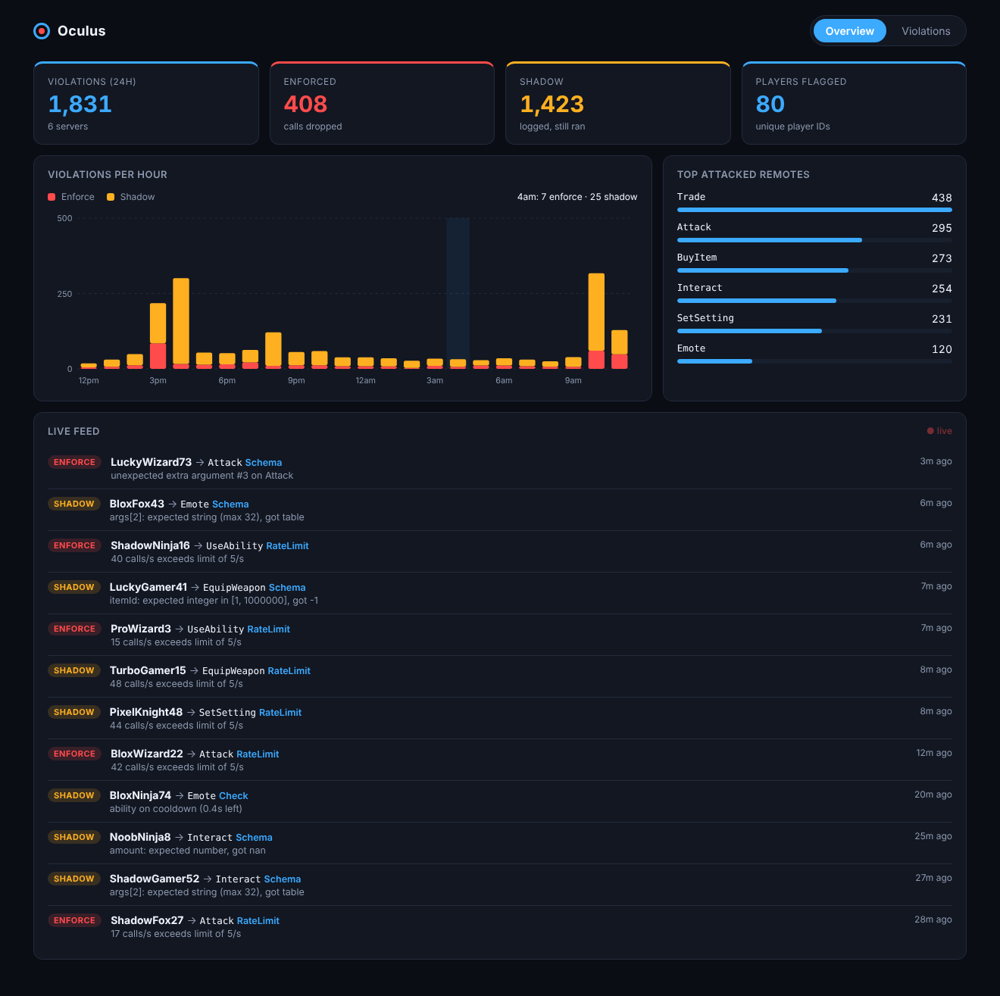
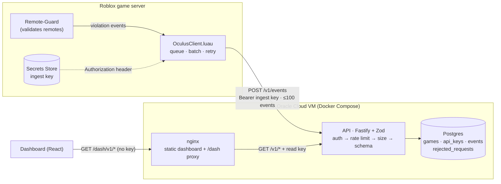

# Oculus

Security telemetry for Roblox games. Game servers running Remote-Guard
report exploit and violation events to a hardened ingest API; a dashboard shows what is being
attacked, by whom, and whether the guard is blocking it (`enforce`) or only watching (`shadow`).


<sub>Overview screen, populated by `npm run seed` (generated demo data, not production traffic).</sub>

## Architecture



Request lifecycle for every endpoint:

```
onRequest:  requireKey(scope)  → 401/403 bad_key        (before the body is read)
            rateLimit(key)     → 429 rate_limited
parse:      bodyLimit 128 KB   → 413 too_large
            JSON parser        → 400 invalid_schema     (malformed JSON, __proto__ keys)
handler:    Zod strict schema  → 400 invalid_schema     (unknown fields, types, ranges)
any refusal → one rejected_requests row (reason, key if known, ip, route, detail)
```

| Folder | What's in it |
| --- | --- |
| `api/` | Node + TypeScript + Fastify API, SQL migrations, key and seed scripts, Vitest tests |
| `web/` | React + TypeScript + Vite dashboard (Overview, Violations, Players, Remotes) |
| `roblox/` | `OculusClient.luau`, the server-side module that ships events |

## Local setup

Requires Node 20+ and Docker.

```bash
docker compose up -d db   # Postgres on localhost:5432 (also creates the test database)
npm install
npm run setup             # migrations + ~2.2k demo events; writes a dev read key to web/.env.local
npm run dev               # API on :3000, dashboard on http://localhost:5173
```

Run the checks CI runs: `npm run lint`, `npm run typecheck`, `npm test`.

## Threat model

Only Roblox game servers can call the ingest API (Roblox clients cannot make HTTP requests),
but the API is on the public internet, so anyone can try. Each defense covers one specific threat:

| Threat | Defense | Where |
| --- | --- | --- |
| Someone posts fake events or reads another game's data | Per-game API key in `Authorization: Bearer`; every query is scoped to the key's game | `plugins/guards.ts`, `repo/` |
| Database leak exposes working keys | Keys stored as SHA-256 hashes only; the raw key is printed once at creation | `lib/keys.ts`, `bin/create-key.ts` |
| Dashboard credentials let someone post events | Separate `read` and `ingest` key scopes; wrong scope → 403 | `api_keys.scope` |
| Read key leaks from the browser | The browser never sees it: the Vite proxy (dev) or nginx (deploy) adds it server-side | `web/vite.config.ts`, `web/nginx.conf.template` |
| A buggy or compromised server floods the API | Token bucket per key (ingest: 20 burst, 60/min) with `Retry-After` | `lib/tokenBucket.ts` |
| Huge bodies exhaust memory | 128 KB body limit, max 100 events per batch | `server.ts`, `schemas/events.ts` |
| Malformed or malicious payloads (extra fields, wrong types, `__proto__`) | Strict Zod schemas (unknown fields rejected), length caps on every string, Fastify's prototype-poisoning check | `schemas/` |
| Replayed or back-dated events skew charts | Timestamps must be within the last 24h and no more than 5 min in the future | `schemas/events.ts` |
| Bad-key floods fill the `rejected_requests` table | Rejection logging is itself rate limited per (reason, IP) | `plugins/errorHandler.ts` |
| Exploiter-controlled text (in violation details) breaks the client | The Luau client truncates every field to the API's limits and replaces invalid UTF-8 | `OculusClient.luau` |
| SQL injection | Parameterized queries only; batches use `unnest()` with typed arrays | `repo/` |
| Key stolen from a game place file | Key lives in the Roblox Secrets Store, never in scripts; rotate with `create-key` | `OculusClient.luau` |

**Why no HMAC request signing:** Roblox Secrets can only be placed in URLs or headers, never
used to compute a signature over the body, so the key is sent as a bearer token.

**Known limits (Milestone 1):**
- TLS is not set up yet. Put a TLS-terminating proxy (e.g. Caddy) in front of the API before
  sending real keys over the internet.
- The dashboard has no user login. Restrict who can reach it (VM firewall, VPN).
- Rate limits are kept in memory, so they're per instance. That's correct for one VM, but
  would need Redis or similar if the API ever runs on several instances.

## API

All endpoints need `Authorization: Bearer <key>`. Every refusal returns `{ "error": "<reason>", "message": "..." }`.

| Method | Path | Key | Returns |
| --- | --- | --- | --- |
| POST | `/v1/events` | ingest | `202 { accepted }` |
| GET | `/v1/stats/summary` | read | 24h totals, enforce/shadow split, unique players/servers, counts by rule |
| GET | `/v1/stats/hourly` | read | 24 hourly buckets `{ hour, shadow, enforce }` |
| GET | `/v1/stats/top-remotes?limit=5` | read | most-hit remotes, 24h (limit 1–20) |
| GET | `/v1/violations?rule=&playerId=&remote=&limit=50&cursor=` | read | newest first, keyset-paginated (`nextCursor`); optional rule / player / remote filters |
| GET | `/v1/players?window=24h&sort=total&q=&limit=25&offset=0` | read | one row per player: latest name, total/enforced/shadowed, rules hit, remotes hit, first/last seen. `sort`: `total`, `enforced`, `lastSeen`. `q`: name prefix, or an exact player ID if numeric. Offset-paginated (`nextOffset`; limit ≤ 50, offset ≤ 1000) |
| GET | `/v1/players/:playerId?window=24h` | read | summary, `byRule`, `byRemote`, distinct servers, time `buckets`; 404 if the player has no events in this game |
| GET | `/v1/remotes?window=24h&sort=total` | read | one row per remote (up to 200): totals, unique players, `byRule`, last seen, current `mode` (of its newest event), time `buckets` for a sparkline. `sort`: `total`, `enforced`, `uniquePlayers` |
| GET | `/v1/remotes/:remote?window=24h` | read | summary, `byRule`, top 10 players, time `buckets`; 404 if the remote has no events in this game. URL-encode the name (≤ 100 chars) |

`window` is `1h`, `24h` (default) or `7d`. Chart `buckets` are `{ start, shadow, enforce }`, oldest first:
12 × 5 min, 24 × 1 h or 28 × 6 h. They are rolling (the newest ends at the time of the request), and
each response's queries read one database snapshot, so buckets and breakdowns always add up to the
totals. Player and remote lists use offset paging because they are sorted by counts computed per
request, which no index can seek on; the violations list keeps keyset paging. A remote named exactly
`.` or `..` can't be opened by path (URL parsers drop dot segments), but still shows in lists and
timelines.

Event shape (`timestamp` is Unix milliseconds):

```json
{ "events": [{ "timestamp": 1763664000000, "serverId": "6c1f…", "playerId": 123456,
  "playerName": "Builderman", "remote": "Attack", "rule": "RateLimit",
  "detail": "40 calls/s exceeds limit of 5/s", "mode": "enforce" }] }
```

## Roblox setup

1. Create an ingest key: `npm run create-key -w api -- --game "My Game" --universe <universeId> --scope ingest`.
2. In Creator Hub, add it as a secret named `OculusApiKey` for your experience, and turn on **Allow HTTP Requests**.
3. Put `roblox/OculusClient.luau` in `ServerScriptService` and attach it to Remote-Guard:

```lua
local Guard = require(ServerScriptService.RemoteGuard)
local Oculus = require(ServerScriptService.OculusClient)

local oculus = Oculus.new({ url = "https://<your-host>/v1/events" })
Guard.logger:addSink(oculus:sink())
game:BindToClose(function()
	oculus:close()
end)
```

The client flushes every 5s (up to 3 batches of 100), retries 429/5xx/network errors with
exponential backoff and jitter, drops 4xx batches immediately, and caps its queue at 1000
events (with one warning per interval).

## Deploy (Oracle Cloud VM)

```bash
cp .env.example .env    # set POSTGRES_PASSWORD and OCULUS_READ_KEY
docker compose --profile deploy up -d --build
```

The API listens on `:3000` (applies migrations on start), the dashboard on `:8080`, and Postgres
is bound to localhost only. The dashboard container refuses to start if `OCULUS_READ_KEY` is empty
(check `docker compose logs web`). Its nginx proxy forwards the raw, still-encoded path to the API,
like the Vite dev proxy does, so remote names containing `/` (sent as `%2F`) open correctly.

## Tests

128 API tests (Vitest, against a real Postgres via `app.inject()`, no network):
validation (11 bad-payload cases, malformed JSON, prototype pollution), auth (missing, malformed,
unknown, revoked, wrong-scope keys), payload size, per-key rate limiting, rejection-log
flood cap, and every query endpoint (24h window, per-game isolation, rule filter, cursor paging
with no gaps or duplicates).

The Players and Remotes endpoints add: events just inside vs just outside each window (1h, 24h, 7d),
bucket edges, every sort, name/ID search (renamed players, literal `%` and `_`), the offset and row
caps, URL-encoded remote names, 404 without a rejection log, strict validation of every param, 403/401
for ingest or missing keys, the violations `playerId`/`remote` filters combined with `rule` and
cursor paging, and the read-only snapshot that keeps a response's numbers consistent while ingest runs.

## Metrics

Not measured yet. Fill these in from real usage, not the seed:
- **Ingest throughput and p95 latency.** Load-test `POST /v1/events` with 100-event batches (e.g. `autocannon`).
- **Events per day and rejected-request mix.** `SELECT reason, count(*) FROM rejected_requests GROUP BY reason`.
- **Client drop rate.** Count `[Oculus] dropped` warnings in live server logs.
- **Query time on the dashboard endpoints** at your real data volume (`EXPLAIN ANALYZE`).
